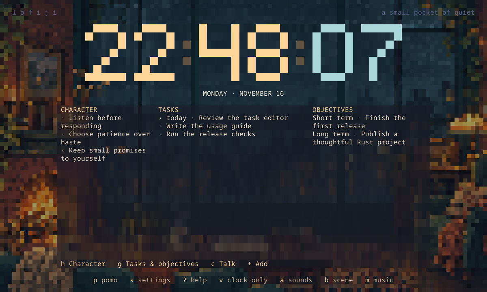

# Lofiji

**A small pocket of quiet for your terminal.**

Lofiji is a Linux terminal desk clock with animated pixel-art scenes. Leave it open for the time and a little atmosphere, or use the workspace beneath the clock to plan your next step and start a focus session.

**Work in progress.** The core clock and workspace are usable. Expect the interface and setup to evolve.



## What you can do with it

| If you’re… | Try this |
| --- | --- |
| **Studying or writing** | Open Pomodoro with **p** and start with **Space**. To focus on a specific task, select it under **g** and press **F**. When the session ends, press **y** to complete the task or **Esc** to keep it open. |
| **Juggling a project and a deadline** | Capture a task with **+** and press **Tab** for a description. The dashboard puts overdue and due-today tasks first, wraps long titles, and lists active short- and long-term goals. Scroll with **↑/↓**. |
| **Building a habit** | Use **h** to keep a short character reminder in sight, such as “Listen before responding.” Pause it when it no longer needs your attention. |
| **Looking for a next step** | Open **Talk** with **c** for local guidance or optional AI chat. With a provider connected, **d** asks for one concrete first action on your top pending task and may suggest a relevant app shortcut. |
| **Setting the mood** | Press **a** to mix ambience and **v** inside the mixer to audition it. Keys **1–3** load Hearth, Café, or Forest. Volume changes keep the loops playing, and **Esc** restores the previous mix. |
| **Keeping a clock on a second screen** | Press **v** on the clock screen for clock-only view. Cycle scenes with **b** or clock styles with **t**. Preview palettes, brightness, and dashboard opacity in **Settings → Appearance**. Custom PNGs and GIFs are supported. |

The clock, bundled scenes, timer, and planner work offline. Ambient loops work offline with **mpv**. YouTube playback is optional and requires **mpv**, **yt-dlp**, and **Node.js**.


[Scene gallery](docs/scenes.png) · [Rain Room](docs/rain-room.png) · [Compact view](docs/plan-compact.png) · [Sound mixer](docs/sounds.png) · [Talk view](docs/conversation.png)

## Start here

You’ll need Linux, Rust **1.74+**, and a true-color terminal such as Kitty.

```sh
git clone https://github.com/Partido-De-What/lofiji.git
cd lofiji
cargo run --release --locked
```

Press **?** for shortcuts and **s** for settings. Save settings with **Ctrl+S**. The user guide covers customization, audio, and optional launch at desktop login. [User guide](docs/usage.md)

## Optional AI

Lofiji supports **ChatGPT plan sign-in**, **OpenAI API**, **Anthropic Claude**, **Google Gemini**, **Ollama**, **OpenRouter**, and **OpenAI-compatible endpoints**. Choose one under **Settings → AI**. For Claude or Gemini, enter a model ID available to your account and supply the API key through an environment variable. [AI setup and provider requirements](docs/ai.md)

AI starts off. Goals, tasks, and reminders are saved locally. A daily suggestion can run while you chat, and **Ctrl+K** cancels the current chat reply. Cloud requests include relevant planner entries, including task descriptions. Talk also sends recent chat. You decide which suggested changes to save.

## Development

```sh
cargo test --locked
cargo clippy --locked --all-targets -- -D warnings
```

Issues and pull requests are welcome while Lofiji takes shape. Please include your terminal and window size when reporting a display issue. [Design notes](docs/design.md) · [Verification](docs/verification.md)

[MIT license](LICENSE) · [Artwork credits](assets/wallpapers/LICENSE.md) · [Audio credits](assets/sounds/LICENSE.md)
