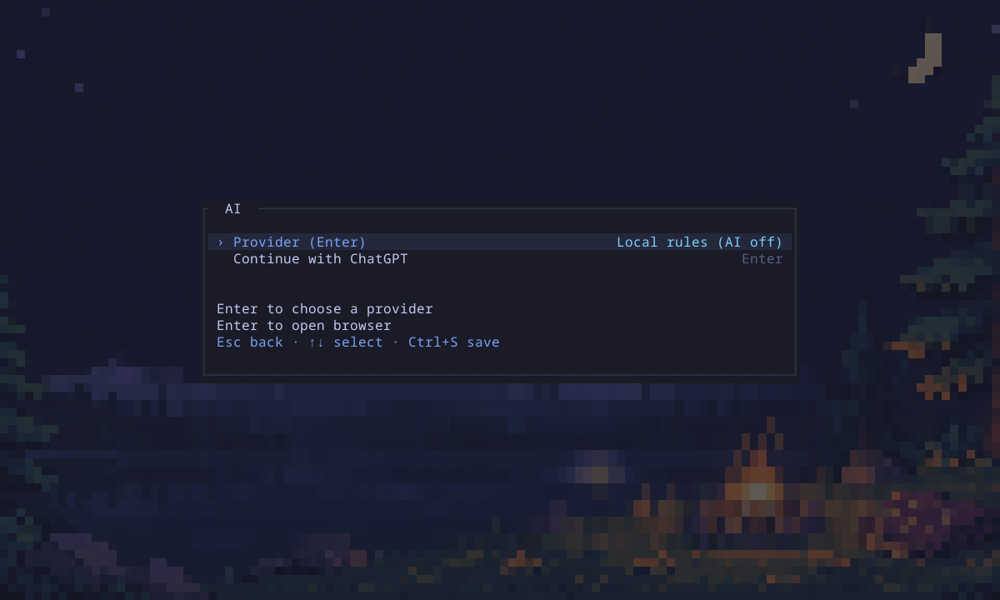

# AI setup

Lofiji supports one active provider at a time. Switching **AI provider** in Settings remembers the last model, API base and key-variable name for each provider. Model IDs are editable: use an ID available to your account, or a model tag installed on your local server. Lofiji does not download models or choose a paid model for you.

| Provider in Settings | Config value | API base when blank | Key variable when blank |
| --- | --- | --- | --- |
| ChatGPT plan | `chatgpt` | Fixed OpenAI endpoint | Browser sign-in |
| OpenAI | `openai` | `https://api.openai.com/v1` | `OPENAI_API_KEY` |
| Anthropic Claude | `anthropic` | `https://api.anthropic.com/v1` | `ANTHROPIC_API_KEY` |
| Google Gemini | `gemini` | `https://generativelanguage.googleapis.com/v1beta` | `GOOGLE_API_KEY`, then `GEMINI_API_KEY` |
| Ollama | `ollama` | `http://127.0.0.1:11434` | None |
| OpenRouter | `openrouter` | `https://openrouter.ai/api/v1` | `OPENROUTER_API_KEY` |
| OpenAI-compatible | `compatible` | Set your server's API base, including `/v1` when required | Optional; set its variable name |
| Local rules (AI off) | `off` | No network request | None |

The adapters use [OpenAI Responses](https://developers.openai.com/api/reference/resources/responses/methods/create), [Anthropic Messages](https://platform.claude.com/docs/en/api/messages/create), [Gemini generateContent](https://ai.google.dev/api/generate-content), [Ollama chat](https://docs.ollama.com/api/chat), and [OpenRouter Chat Completions](https://openrouter.ai/docs/api-reference/overview). The compatible adapter uses the Chat Completions shape. Choose a model supported by that API; model access and availability belong to your provider/account.

## Claude and Gemini quick setup

1. Set an API key in the shell that launches Lofiji. Use `ANTHROPIC_API_KEY` for Claude or `GEMINI_API_KEY` for Gemini.
2. Open **Settings → AI → Provider** and choose **Anthropic Claude** or **Google Gemini**.
3. Enter an API model ID available to your account. Leave the API base and key-variable fields blank for the defaults above. Press **Ctrl+S**, then **c** to chat.

Claude uses the Messages API with Bearer authentication for the current API version. If your key requires workspace selection, set `ANTHROPIC_WORKSPACE_ID` for the default Claude endpoint. An explicit `anthropic_version = "2023-06-01"` uses the legacy key header. [Claude authentication](https://platform.claude.com/docs/en/manage-claude/authentication) · [API versions](https://platform.claude.com/docs/en/api/versioning)

Gemini uses the GenerateContent API and sends the key in its authentication header. Both bare model IDs and the `models/` prefix are accepted. [Gemini API keys](https://ai.google.dev/gemini-api/docs/api-key) · [GenerateContent](https://ai.google.dev/api/generate-content)

## Use your ChatGPT subscription

Eligible Plus and Pro accounts can authorize Lofiji through OpenAI’s [Sign in with ChatGPT preview](https://developers.openai.com/siwc/token-sharing-open-source). This option uses your plan’s allowance. The separate **OpenAI** provider uses API billing.

1. In Lofiji, press **s** and open **AI** (or press **End** from Settings). Press **Enter** on **Continue with ChatGPT**. If an API provider is already selected, open **Provider**, select **ChatGPT plan**, then press **Enter** on **Continue with ChatGPT**.
2. Sign in and approve Lofiji in your browser. Lofiji loads your account’s models and highlights **Model**. **Automatic** uses the first model in the account’s OpenAI catalog. OpenAI’s public catalog does not identify a separate default for the ChatGPT web app.
3. To pick a different model, press **Enter** on **Model**, move with **↑/↓**, and press **Enter** again. Press **Ctrl+S** to save, then **c** to chat or **d** for a daily suggestion.

The ChatGPT plan page hides the API key and custom endpoint fields. Selecting an API provider brings those controls back.

Browser sign-in requires Python 3.8 or later, its `cryptography` package, and `xdg-open`. On Arch Linux the corresponding packages are `python`, `python-cryptography`, and `xdg-utils`. The ChatGPT plan provider works at desktop login after the first authorization because it saves the renewable session in a private file beside your settings, usually `~/.config/lofiji/config.chatgpt.json`. Keep that file private.

Use the Settings entries below **Continue with ChatGPT** to add another account, cycle through saved accounts, or sign out. You can also disconnect Lofiji and check your plan limits in [ChatGPT Settings → Usage](https://chatgpt.com/settings/usage).

## Set up from the TUI

1. Press **s** and select **AI**.
2. Open **Provider** with Enter and choose it with ↑/↓ and Enter.
3. For an API or local provider, edit **Model** with Enter and enter its model ID.
4. Leave **AI API base** blank for the default above, or enter a proxy/local server's base URL. Use the base, not the full `/responses`, `/messages`, or `/chat/completions` route.
5. **AI key variable** takes an environment-variable name, never the API key itself. Blank uses the provider default; a local unauthenticated server needs no variable.
6. Ctrl-S saves. Press **c** to converse, or **d** to request an AI suggestion beneath the clock.



For Gemini, leave the key-variable field blank to use `GOOGLE_API_KEY` or `GEMINI_API_KEY`. If both are set, `GOOGLE_API_KEY` takes precedence. Enter a variable name to pin one explicitly. For a compatible service, set both its API base and key-variable name when authentication is required. Remote endpoints require HTTPS; HTTP is allowed for localhost, 127.0.0.1 and ::1. Local requests bypass proxy environment settings.

The API-key providers and local HTTP providers need **curl**. The rest of the clock, local planning and goal editing work without it.

## Make the key available

For example, in Bash, read an OpenAI key without putting the literal key in the command history:

```bash
read -rs -p 'OpenAI API key: ' OPENAI_API_KEY
export OPENAI_API_KEY
~/.local/bin/lofiji
```

Use the corresponding variable from the table for another provider. Lofiji reads only the selected variable when you request AI. It stores the variable's name, not the credential, in its config. Keys go in HTTP authentication headers and are passed to curl through private standard input, rather than command arguments or temporary files.

For automatic login launch, the variable must also be available in your graphical session's environment. An export in one terminal affects that terminal's children; it does not update the already running i3 session. Ollama normally needs no cloud key, but its service and selected model must already be available.

## Daily suggestions and task edits

**AI plan on open** is off by default. Enable it to request a short suggestion when Lofiji opens with a pending task. **d** refreshes manually. Lofiji selects the first pending task using its normal deadline and priority order. The model suggests one concrete action for that task and can include one directly useful shortcut. Without a pending task, the daily plan stays local. Press **c** and ask how to use a feature for more help. Suggestions are cached only for the current session/day and are invalidated when goals/tasks or AI settings change. A late reply for an older task snapshot is discarded. Local guidance remains available if the request fails.

The daily request includes the date, the selected task and its active linked goals. Talk requests include the current date, up to 40 pending tasks, up to 60 active goals, up to 20 active character reminders, and up to 13 recent conversational messages. Structured goal context omits completed and archived entries; earlier conversation can still mention them. Conversation is transient and is not written to a transcript file. Cloud providers receive this context when selected; keep AI off or use a local service if you do not want to send it to a remote endpoint.

AI replies are text suggestions. They cannot execute commands or modify task records. These explicit user commands always run locally, even when AI is enabled:

```text
reminder: Listen before responding
task: Review the proof
short goal: Finish the draft
long goal: Submit the thesis
done #2
```

**PageUp / PageDown** scrolls the conversation. **Esc** returns to the overview and keeps the conversation and draft for this Lofiji session. **Ctrl+K** cancels a reply in progress. **Ctrl+N** starts a new conversation. The waiting animation stays visible while the reply is pending. Requests have a configurable timeout and bounded response size. Authentication failures, missing models, rate limits and malformed responses produce a short error and a local next step. There are no automatic retries.

## Thinking effort

In **Settings → AI**, the **Thinking effort** row sets the default for the selected provider. Use **←/→** to choose **Model default**, **Low**, **Medium** or **High**, then **Ctrl+S** to save. In **Talk**, **Ctrl+E** cycles the same choices for that conversation. The selected level appears next to the provider and applies to subsequent messages.

Supported paths are ChatGPT plan and OpenAI Responses, Claude models that accept effort, OpenRouter models that accept reasoning effort, and Ollama’s `gpt-oss`. Specific models may reject an explicit level. Use **Model default** to let the provider choose.

## Configuration example

Choose a real model ID before using this example:

```toml
[ai]
provider = "openai"
model = "YOUR_MODEL_ID"
base_url = ""
key_env = ""
auto_brief = false
thinking_effort = "model_default"
timeout_seconds = 60
max_tokens = 4096
anthropic_version = "2026-10-21"
```

The last setting selects the Anthropic API version and is ignored by other adapters. Provider-specific model/URL/key references are cached under `[ai.profiles.PROVIDER]` when you switch providers in Settings. Active values remain in `[ai]`. No actual API key belongs in either table.

Protocol behavior is covered by localhost mock-server tests for all six adapters. Live account authentication and model access require your credentials and have not been exercised in this workspace.
