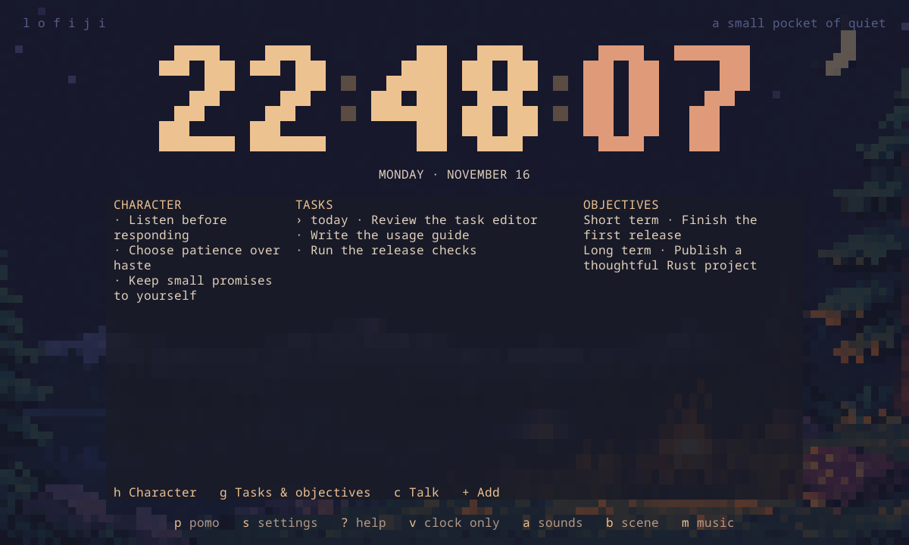
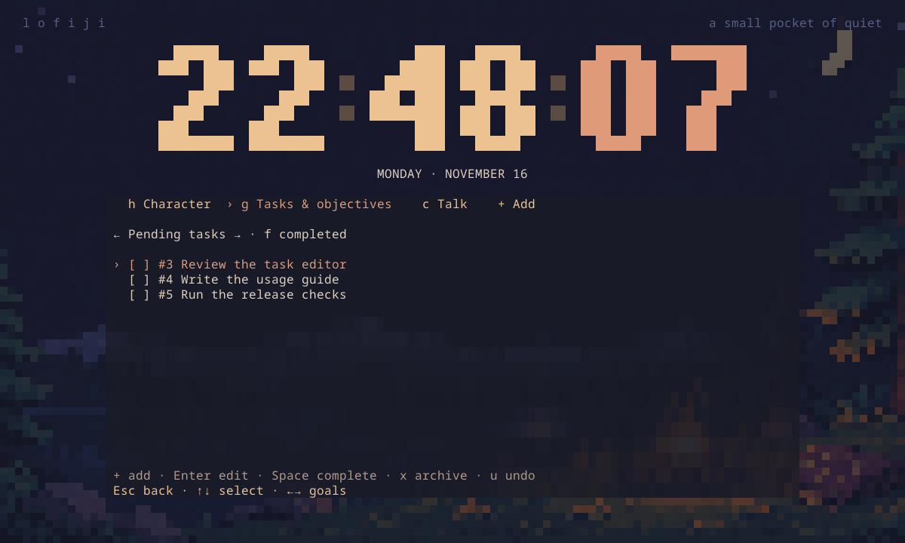
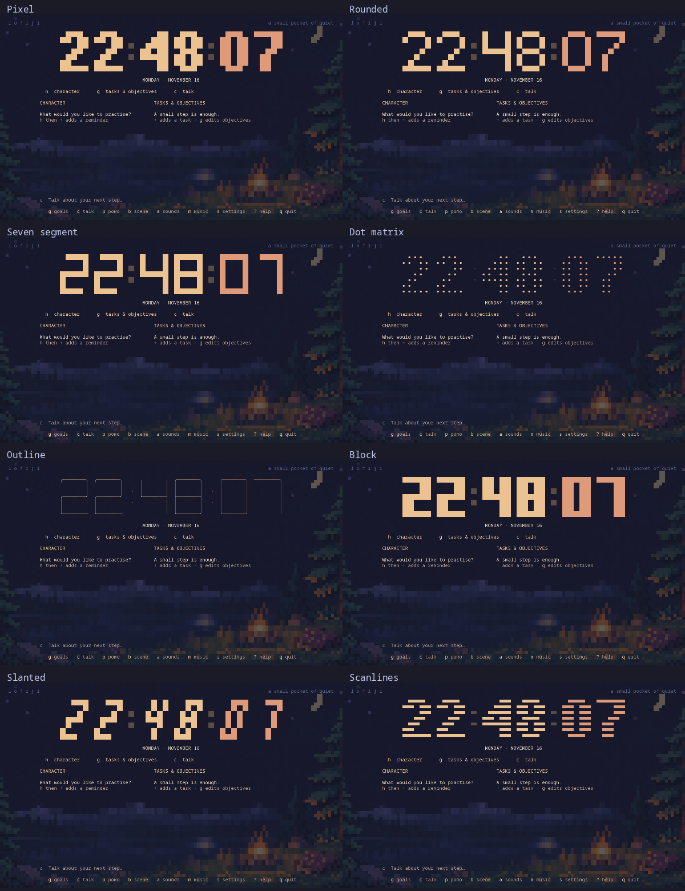
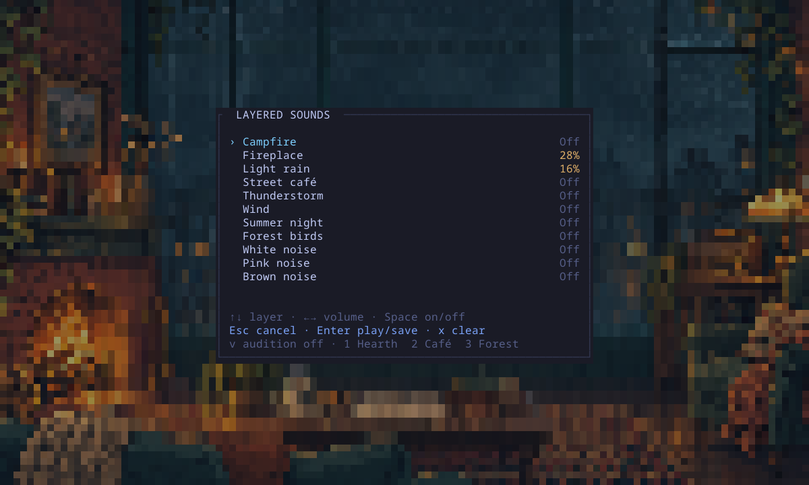

# Lofiji user guide

## Controls

| Key | Action |
| --- | --- |
| `h` | Character reminders: qualities, habits and principles |
| `g` / `+` | Tasks & objectives / quick-add a task |
| `c` | Talk beneath the clock: local rules or your configured AI |
| `d` | Refresh the AI daily suggestion |
| `v` | Show / hide the text workspace |
| `b` | Cycle image scenes and save selection |
| `t` | Cycle clock styles |
| `a` | Layered ambient sound menu |
| `z` | Mute / resume the saved ambient mix |
| `m` | Start / stop YouTube music |
| `w` | Clear / rain / snow overlay |
| `s` | Settings: scenes, images, clock palettes/styles, timer, music |
| `p` | Show / hide Pomodoro |
| `Space` | Start / pause / resume visible Pomodoro |
| `r` / `n` | Reset / skip visible Pomodoro |
| `?` | All shortcuts |
| `q` / `Ctrl-C` | Quit |

Compact footers show fewer shortcuts; `?` always lists the controls.

## Your quiet workspace

The clock sits higher on the screen, leaving room beneath the date for a small text workspace. The overview shows **character reminders** beside **tasks and objectives**, with a menu for **h character**, **g tasks & objectives** and **c talk**. Browsing, editing and talking keep the clock visible in normal and medium windows, using the current clock palette and background.

Character reminders describe qualities or habits you want to practise—for example, “listen before responding.” Press **h**, then **+** to add your own. **Enter** edits, **Space** pauses/resumes a reminder, **x** archives and **u** undoes the last archive. Reminders are ongoing; they do not become tasks or count as completed work. Paused reminders leave the overview and AI context. [Character menu preview](character.png).

Tasks appear in deadline/priority order: overdue, due today, unscheduled, then future deadlines. The overview includes linked short/long-term objectives when space allows. Press **v**, or toggle **Text workspace** in Settings, for the centered clock-only layout. Opening a list or chat makes space for it again. Very small windows simplify the overview and use the compact editor fallback.



[Medium window](plan-medium.png) · [Compact window](plan-compact.png)

Press **+**, type a task and press **Enter** to save. Press **g** to manage tasks and goals:

- **←/→ or Tab** switches between Tasks, Short-term goals and Long-term goals.
- **+ / a** adds an entry; **Enter / e** edits it.
- **Space** completes or reopens an entry. In Tasks, **f** switches between pending and completed work. Pending tasks use the same order as the overview. **p** cycles priority.
- **x** archives the selected entry; **u** undoes the most recent archive while the manager is open.
- **Esc** closes the editor or manager.

The editor starts on the title. **Tab / Shift-Tab** moves between title, linked goal, due date and priority. Use **←/→** to select a goal or priority. Dates use `YYYY-MM-DD`; a blank date means no deadline. Tasks can link to either kind of goal, and short-term goals can link to long-term goals. Completing a goal does not silently complete its tasks.



**c — Talk** opens a [text conversation beneath the clock](conversation.png). **PageUp / PageDown** reads earlier messages; **Esc** returns to the overview. **Ctrl+K** cancels a reply in progress and **Ctrl+N** starts a new chat. With AI off, local rules suggest a next step and understand explicit commands. With an AI provider configured, free-form questions use that model with your active reminder/goal/task context. These commands always save locally:

```text
reminder: Listen before responding
task: Review the proof
short goal: Finish the draft
long goal: Submit the thesis
done #2
```

Conversation history and unsent drafts stay available until you quit Lofiji or start a new chat. Reminders, goals and tasks persist on disk. AI replies offer advice and cannot change records automatically.

Entries are saved next to the selected config: normally `~/.config/lofiji/config.planner.toml`. A custom `--config desk.toml` uses `desk.planner.toml`. Planner files are private (mode 600), atomically replaced, and guarded against stale writes from another instance. Malformed files are reported and preserved. Reopen `g` to refresh changes made in another window. No personal goals are prefilled; preview images use example entries.

## Choose an AI

Settings supports **ChatGPT plan sign-in**, **OpenAI API, Anthropic Claude, Google Gemini, Ollama, OpenRouter**, and **OpenAI-compatible endpoints**. To use an eligible Plus or Pro plan, press **s**, select **AI**, and open **Continue with ChatGPT**. Approve in your browser, choose a model from the account catalog or keep **Automatic**, then press **Ctrl+S**. Select the provider, enter a model ID available to you, and configure its API-key environment-variable name. Switching providers restores its saved model, endpoint and key reference.

AI starts off. **c** talks to the selected model, **d** requests an AI daily suggestion, and **AI plan on open** optionally requests one at launch. A daily suggestion can include one short, relevant Lofiji tip when there’s room beneath the clock. You can also ask **Talk** how to use a feature. Requests run outside rendering and can be cancelled. Errors fall back to local guidance. The optional transport needs `curl`.

Keys are read from environment variables and are not stored as literal credentials in settings. Cloud requests send active reminders, goals/tasks and recent chat to the chosen endpoint. [Provider setup, API defaults and configuration examples](ai.md).

## Open at login

Build and install the login launcher:

```sh
cargo build --release --locked
python3 tools/install_autostart.py
```

Run the installed copy with `~/.local/bin/lofiji`. The installer places the executable in `~/.local/bin/lofiji` and configures a Kitty window for desktop login. On i3, the installer can add a small validated config include. Existing i3 configuration is backed up before the include is added. No session restart is performed.

Run the installer again after rebuilding to update the installed copy. To disable login startup while keeping the app:

```sh
python3 tools/install_autostart.py --disable
```

The app starts after graphical login, with music and ambient sounds off; it does not run before a user session exists.

## Image scenes and GIFs

Every scene now uses a bundled image. The former terminal-drawn buildings, interiors, forest and moon were removed.

| Scene | Format | Appearance |
| --- | --- | --- |
| Rainy window | GIF | Rain on an arched window, blue forest, small warm candle |
| Moonlit city | PNG + motion | Slowly changing windows and twinkling stars |
| Quiet forest | PNG + motion | Drifting clouds, gentle foliage and fireflies |
| Snow mountains | PNG + motion | Drifting clouds and sparse falling snow |
| Bonfire | PNG + motion | Flickering flame, rising embers and shimmering lake reflections |
| Rain Room | PNG + motion | Teal windows over a rain-soaked city, a reading nook, and a softly flickering hearth |
| Custom | PNG / GIF | Your own image; blank path uses the rainy window |

Use `b` or the **Background** row in Settings. **Image path** accepts absolute paths, `~/…`, or paths relative to the config directory. Images are decoded and cached on selection. Half-block pixels preserve aspect ratio with a centered cover crop and adjustable dimming; the clock stays clear above the artwork.

**Scene motion** plays GIFs, localized PNG scene effects and weather. Turning it off freezes every effect at its initial frame. GIFs support frame offsets, transparency, disposal and source delays, with drawing capped at 10 fps; very short/zero frame delays use a 100 ms fallback. Missed draws skip to the correct animation position. Built-in PNGs retain their original artwork and use localized motion; custom PNGs stay static. [Scene motion preview](scene-motion.gif). A custom GIF must fit within 64 MiB of decoded frames and 512 frames; use a modest resolution such as 320×180.

```sh
lofiji --background bonfire
lofiji --background rain-room
lofiji --background forest --weather rain
lofiji --image ~/Pictures/lofi.gif
```

The rainy window and SpritePilot scenes are CC0. Bonfire and Rain Room were generated for Lofiji. [Art credits and licenses](../assets/wallpapers/LICENSE.md) · [Rain preview](rain.gif).

## Clock styles and palettes

Press `t` or change **Clock style** in Settings: Pixel, Rounded, Seven segment, Dot matrix, Outline, Block, Slanted, Scanlines. Each style also has a compact rendering for shorter windows; tiny windows use plain time for readability.



[Full numeral audit](numerals.png) · [Compact numeral audit](numerals-compact.png)

**Clock palette → Scene** selects Moonlight for the window/snow, Tokyo for the city, Sage for the forest, Ember for the bonfire, and Hearthlight for Rain Room. You can select and edit any preset in Appearance.

| Rain Room palette | Hours and minutes | Seconds | Separator | Date and controls |
| --- | --- | --- | --- | --- |
| Hearthlight | `#ffd69a` | `#a8d6da` | `#c3a685` | `#ead9c1` |
| Rain Glass | `#bde8e9` | `#f5bd81` | `#8eafb9` | `#d2e4e4` |

Both previews use clock-only view and 60% image brightness. [Hearthlight with Rounded numerals](rain-room.png) · [Rain Glass with Seven segment numerals](rain-room-glass.png)

The four color rows beneath **Clock palette** edit hours/minutes, seconds, separators and date. Press Enter, type a `#RRGGBB` value, then Enter to accept and Ctrl-S to save. Changes modify and persist that preset; with **Scene** selected they modify the preset assigned to the current scene. Style and colors are independent. Advanced users can add named entries to `clock_palettes` in the config.

## Layered sounds

Optional **mpv** is required; no YouTube extractor or internet connection is needed for ambient sounds.



Press `a`: ↑/↓ selects a layer, ←/→ adjusts volume, Space switches it on/off. **Enter plays and saves the mix**, `x` clears the draft, Esc cancels. `z` mutes/resumes the saved mix from the clock screen. Each layer has an independent volume and can play alongside YouTube music.

Included: campfire, a separate indoor fireplace, light rain, street café, thunderstorm, wind, summer night, forest birds, white noise, pink noise and brown noise. The fireplace sits next to Campfire in the menu and has its own volume. It uses a bundled [CC0 wood-burning fireplace loop](https://opengameart.org/content/fireplace-sound-loop), included as an offline ambience. Environmental recordings have crossfaded loop seams; colored noise is synthesized. [Sources and licenses](../assets/sounds/LICENSE.md).

Saved volumes are remembered; sounds stay off on each launch. Changing one layer preserves other running layers. Owned players and temporary sound files are cleaned up on normal exit and handled termination signals.

## Settings

Open **Appearance**, **Pomodoro**, **Audio**, or **AI** with Enter. Use ↑/↓ or j/k to select, and ←/→ to change values. Enter opens text fields or changes a toggle. In a text field, Enter accepts the field and Esc cancels its edits. Esc goes back to the section menu, then closes Settings. **Ctrl+S** saves the draft and closes Settings.

Settings live at `$XDG_CONFIG_HOME/lofiji/config.toml`, falling back to `~/.config/lofiji/config.toml`. `--config PATH` selects another file. Preferences from the former Nekoji directory import if the Lofiji file is absent. Old scene names migrate to image scenes. Invalid files are reported without overwriting them. [Example](../config.example.toml).

```sh
lofiji --check-config
```

## YouTube music

Install **mpv**, **yt-dlp**, and **Node.js** for optional streamed music. Lofiji also finds yt-dlp in `~/.local/bin`.

Default: [the selected Lofi Coffee video](https://www.youtube.com/watch?v=DEWzT1geuPU). Edit its YouTube/youtu.be HTTPS URL and volume in Settings. `m` starts/stops music; `--music` opts in on launch. Music normally starts off. Saving a changed URL/volume restarts that player.

```sh
lofiji --music
lofiji --music-url 'https://www.youtube.com/watch?v=DEWzT1geuPU'
```

The footer shows **loading…** until audio initializes. Stream failures show sanitized status messages. Playback prefers HLS audio to avoid direct-stream 403 errors; YouTube can still change or restrict sources. Audio has no video window or leaked terminal output and stops on exit. [mpv](https://mpv.io/manual/stable/) · [yt-dlp](https://github.com/yt-dlp/yt-dlp).

## Pomodoro

Defaults: 25-minute focus, 5-minute short break, 15-minute long break after four completed focus sessions. Durations are editable (1–180 minutes). Skipping a focus does not count as completion. Hiding Pomodoro keeps it running; the clock remains prominent.

Auto transitions and notifications start off. Settings offer a terminal bell or optional `notify-send` desktop notifications. Running/paused sessions retain their duration after settings edits. Monotonic deadlines prevent render/resize drift and catch up after process suspension. Sessions are not persisted across restarts; Linux monotonic time excludes system sleep.

[Pomodoro](pomodoro.png) · [Compact clock](compact.png)

## Development

```sh
cargo fmt --check
cargo test --locked
cargo clippy --locked --all-targets -- -D warnings
cargo build --locked
python3 tests/pty_smoke.py
python3 tests/features_smoke.py
python3 tests/planner_smoke.py
python3 tests/autostart_smoke.py
python3 tests/ai_smoke.py
cargo build --release --locked
# Optional preview exports: Pillow, Fontconfig and rsvg-convert
python3 tools/preview_scenes.py
# Just clock styles and numeral audits:
python3 tools/preview_clock_styles.py
```

Deterministic snapshots use the live renderer without entering the alternate screen or starting audio:

```sh
lofiji --snapshot 120x36 --background bonfire --at 2026-11-16T22:48:07 --output bonfire.svg
lofiji --snapshot 80x24 --mode sounds
```

Modes: clock, focus, paused, break, settings, sounds, help, plan, goals, character, conversation, ai_settings. The plan, goals, character and conversation modes use example entries, never personal entries. `--elapsed` selects animation time. [Design](design.md) · [Verification](verification.md).
